<div align="center">

# Metapi Evolution

**中转站的中转站 — 将分散的 AI 中转站聚合为一个统一网关**

把你在各处注册的 New API / One API / OneHub / Done Hub / Veloera / AnyRouter / Sub2API 等站点，
汇聚成 **一个 API Key、一个入口**——自动发现模型、智能路由、成本最优。

[界面預覽](#-界面預覽) · [文档](https://yswlww.github.io/metapi-evolution) · [快速开始](#-快速开始) · [下载桌面版](https://github.com/yswlww/metapi-evolution/releases) · [报告问题](https://github.com/yswlww/metapi-evolution/issues)

<p>
<a href="https://github.com/yswlww/metapi-evolution/releases">
  
</a>
<a href="https://github.com/yswlww/metapi-evolution/stargazers">
  
</a>
<a href="https://hub.docker.com/r/kennethww/metapi-evolution">
  
</a>
<a href="https://github.com/yswlww/metapi-evolution/actions/workflows/ci.yml">
  
</a>
<a href="LICENSE">
  
</a>


<a href="https://zeabur.com/templates/DOX5PR">
  
</a>
<a href="https://render.com/deploy?repo=https://github.com/yswlww/metapi-evolution">
  
</a>
</p>

<p align="center">
  <a href="README.md"><strong>中文</strong></a> |
  <a href="README_EN.md">English</a>
</p>

</div>

---

## 🌐 界面預覽

Metapi Evolution 的預設界面——深色為主的設計語言，支援簡中 / 繁中 / English 三語切換，全部管理功能都在同一個控制台內完成。

<p align="center">
  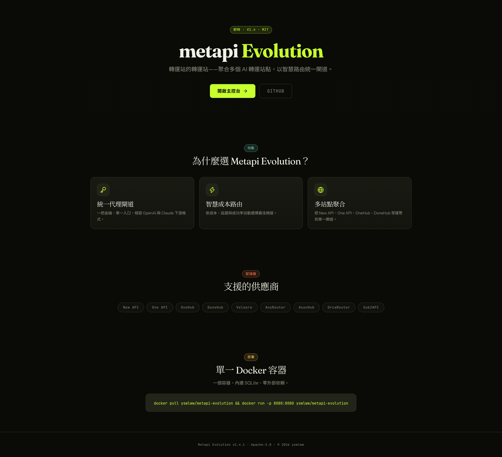
</p>

<table>
  <tr>
    <td align="center" width="50%">
      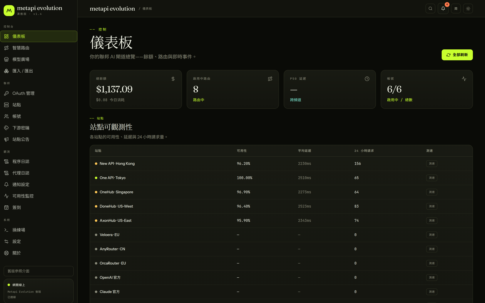
      <div><b>儀表板</b> — 餘額、路由與即時事件總覽</div>
    </td>
    <td align="center" width="50%">
      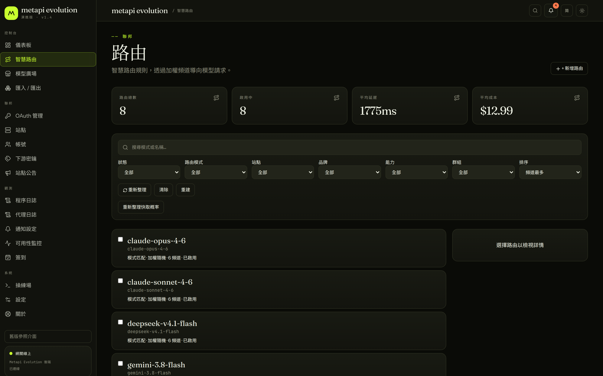
      <div><b>智慧路由</b> — 正則比對、加權隨機、多通道故障轉移</div>
    </td>
  </tr>
  <tr>
    <td align="center">
      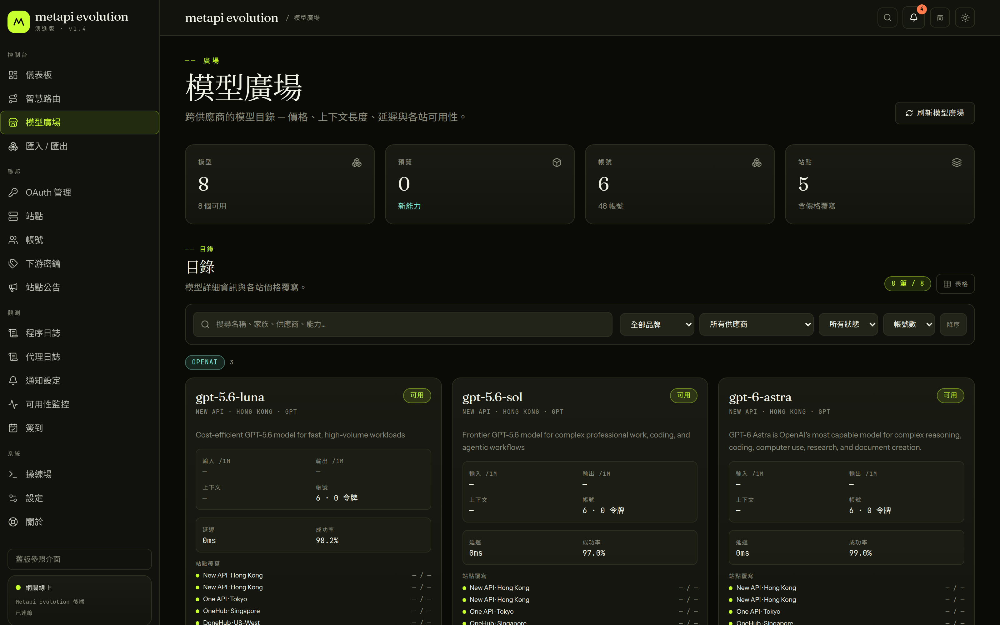
      <div><b>模型廣場</b> — 跨站模型覆蓋、定價與可用性</div>
    </td>
    <td align="center">
      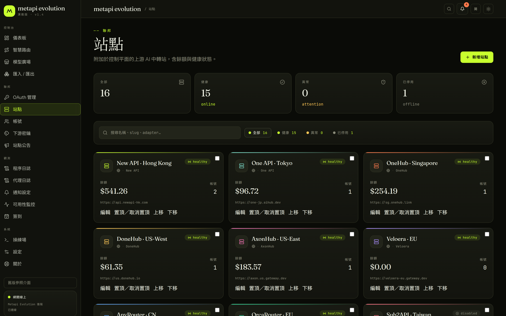
      <div><b>站點管理</b> — 上游站點、適配器與健康狀態</div>
    </td>
  </tr>
  <tr>
    <td align="center">
      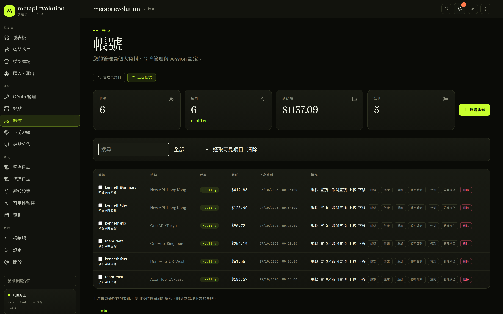
      <div><b>帳號管理</b> — 多站點多帳號、憑證與連線模式</div>
    </td>
    <td align="center">
      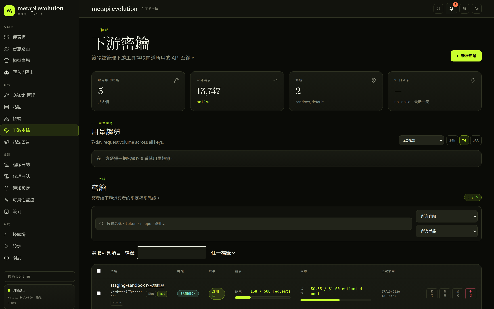
      <div><b>下游密鑰</b> — 模型白名單、分組、用量與成本</div>
    </td>
  </tr>
  <tr>
    <td align="center">
      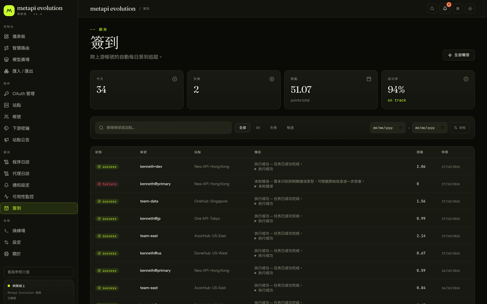
      <div><b>自動簽到</b> — 排程執行與獎勵記錄</div>
    </td>
    <td align="center">
      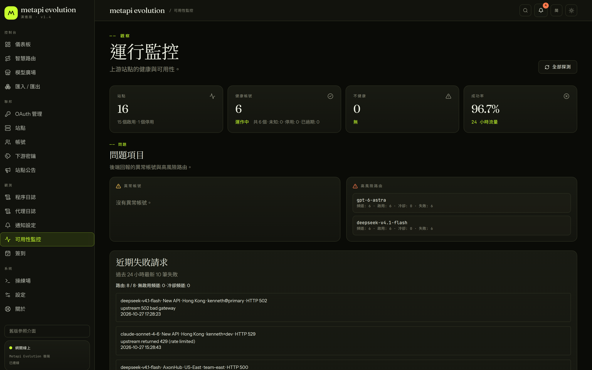
      <div><b>可用性監控</b> — 通道健康度與延遲趨勢</div>
    </td>
  </tr>
  <tr>
    <td align="center">
      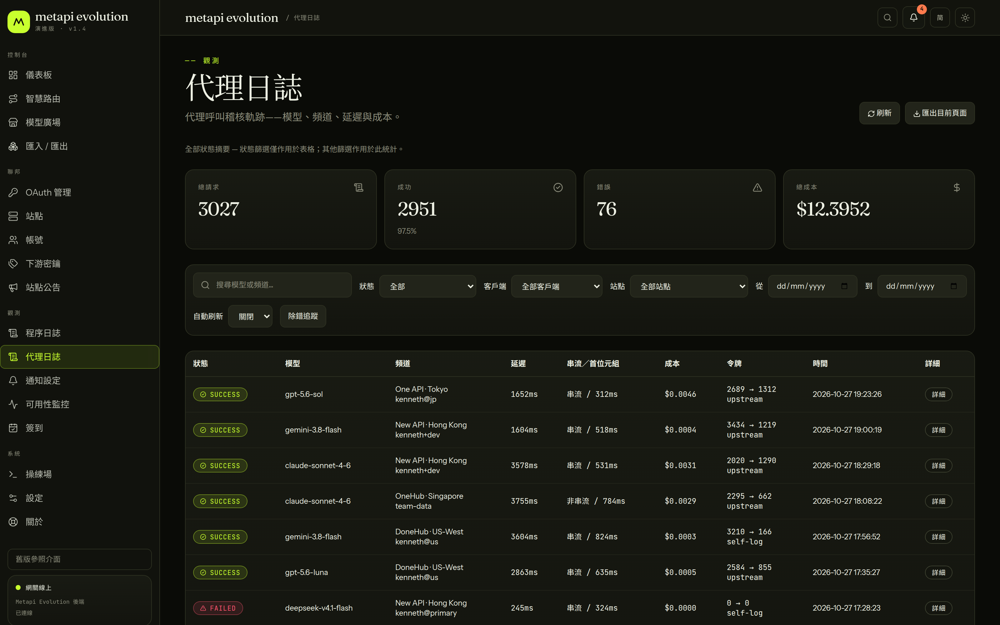
      <div><b>代理日誌</b> — 請求記錄、Token 用量與成本明細</div>
    </td>
    <td align="center">
      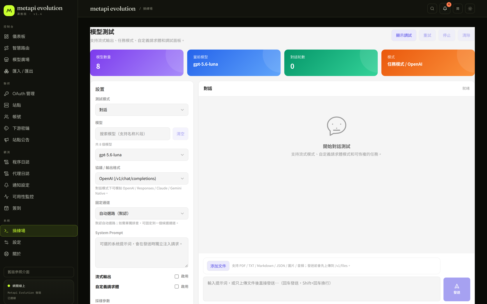
      <div><b>模型操練場</b> — 直接在控制台測試模型</div>
    </td>
  </tr>
</table>

> 以上截圖以虛構的示範資料產生，不含任何真實站點或憑證。


---

## 🤔 为什么选 Metapi Evolution？

现在 AI 生态里有大量基于 New API / One API 系列的聚合中转站。要在多个站点间管理余额、模型和密钥，往往既分散又费时。**Metapi Evolution 是这些中转站之上的「元聚合层」（Meta-Aggregation Layer）**：多个站点统一为一个入口，下游所有工具（Cursor、Claude Code、Codex、Open WebUI 等）无感接入全部模型。

| 有了多个中转站之后…                        | Metapi Evolution 怎么解决                                                        |
| ------------------------------------- | ---------------------------------------------------------------------- |
| 🔑 每个站点一个 Key，下游工具配置一堆 | **统一代理入口 + 可选多下游 Key 策略**，模型自动聚合到 `/v1/*` |
| 💸 不知道哪个站点用某个模型最便宜     | **智能路由** 自动按成本、余额、使用率选最优通道                  |
| 🔄 某个站点挂了，手动切换好麻烦       | **自动故障转移**，一个通道失败自动冷却并切到下一个               |
| 📊 余额分散在各处，不知道还剩多少     | **集中看板** 一目了然，余额不足自动告警                          |
| ✅ 每天得去各站签到领额度             | **自动签到** 定时执行，奖励自动追踪                              |
| 🤷 不知道哪个站有什么模型             | **自动模型发现**，上游新增模型零配置出现在你的模型列表里         |
| ⬆️ 单容器更新还要搭建集群             | **[应用内升级](docs/update-center.md)**，校验升级包、自动重启与一次性失败回退（Linux amd64 / arm64） |

**支持的上游范围**已经不止传统聚合面板：

- **聚合面板**：[New API](https://github.com/QuantumNous/new-api)、[One API](https://github.com/songquanpeng/one-api)、[OneHub](https://github.com/MartialBE/one-hub)、[DoneHub](https://github.com/deanxv/done-hub)、[Veloera](https://github.com/Veloera/Veloera)、[AnyRouter](https://anyrouter.top)、[Sub2API](https://github.com/Wei-Shaw/sub2api)、[AxonHub](https://github.com/looplj/axonhub)
- **通用兼容接口**：OrcaRouter（OpenAI 兼容 API Key）、OpenAI / Claude / Gemini 兼容端点，以及 `cliproxyapi` / CPA
- **官方预设**：阿里云 / 智谱 / 豆包 Coding Plan，DeepSeek，Moonshot(Kimi)，MiniMax，ModelScope
- **OAuth 连接**：Codex、Claude、Gemini CLI、Antigravity

---

## 🖥️ 兩套界面

**Metapi Evolution 界面（默认）** 与旧版参考界面同时打包在同一个镜像里，共用同一套后端与同一份管理员登录状态：

| 路径 | 界面 | 说明 |
| --- | --- | --- |
| `/` | **Metapi Evolution**（默认） | 深色三语言（简中 / 繁中 / English）界面，页面按需加载，覆盖全部管理功能 |
| `/legacy/` | 旧版参考界面 | 与旧版本完全一致，便于比对与回退 |

在默认界面左下角点击「旧版参照界面」即可切换过去；在旧版直接访问 `/` 即可回到新版，**无需重新登录**。

新版界面在旧版基础上补齐了这些能力：

- **真实流程**：OAuth 授权会保留会话并引导完成 consent；通知配置、备份与更新中心均真实写入并可重载确认
- **契约修复**：路由策略、模型成功率与定价、公告正文与已读状态、日志事件分类等全部对齐后端契约，不再展示占位数据
- **管理能力**：账号 / 令牌的完整编辑与批量操作、站点排序与代理、下游密钥的权限清空与移动端批量选择
- **可访问性**：语义化标签、原生表单控件、键盘操作与 `prefers-color-scheme` 主题跟随


---

## 🚀 快速开始

<a href="https://zeabur.com/templates/DOX5PR">
  
</a>
<a href="https://render.com/deploy?repo=https://github.com/yswlww/metapi-evolution">
  
</a>

### Docker Compose（推荐）

```bash
mkdir metapi && cd metapi

cat > docker-compose.yml << 'EOF'
services:
  metapi:
    image: kennethww/metapi-evolution:latest
    ports:
      - "127.0.0.1:${PORT:-4000}:${PORT:-4000}"
    volumes:
      - ./data:/app/data
    environment:
      AUTH_TOKEN: ${AUTH_TOKEN:?AUTH_TOKEN is required}
      PROXY_TOKEN: ${PROXY_TOKEN:?PROXY_TOKEN is required}
      ACCOUNT_CREDENTIAL_SECRET: "${ACCOUNT_CREDENTIAL_SECRET:-}"
      CHECKIN_CRON: "${CHECKIN_CRON:-0 8 * * *}"
      BALANCE_REFRESH_CRON: "${BALANCE_REFRESH_CRON:-0 * * * *}"
      PORT: ${PORT:-4000}
      DATA_DIR: /app/data
      TZ: ${TZ:-Asia/Shanghai}
      NOTIFY_COOLDOWN_SEC: ${NOTIFY_COOLDOWN_SEC:-300}
      ADMIN_IP_ALLOWLIST: "${ADMIN_IP_ALLOWLIST:-}"
      SYSTEM_PROXY_URL: "${SYSTEM_PROXY_URL:-}"
      GEMINI_CLI_CLIENT_ID: "${GEMINI_CLI_CLIENT_ID:-}"
      GEMINI_CLI_CLIENT_SECRET: "${GEMINI_CLI_CLIENT_SECRET:-}"
      ANTIGRAVITY_CLIENT_ID: "${ANTIGRAVITY_CLIENT_ID:-}"
      ANTIGRAVITY_CLIENT_SECRET: "${ANTIGRAVITY_CLIENT_SECRET:-}"
      TELEGRAM_ENABLED: ${TELEGRAM_ENABLED:-false}
      TELEGRAM_BOT_TOKEN: "${TELEGRAM_BOT_TOKEN:-}"
      TELEGRAM_CHAT_ID: "${TELEGRAM_CHAT_ID:-}"
      TELEGRAM_API_BASE_URL: "${TELEGRAM_API_BASE_URL:-}"
      TELEGRAM_MESSAGE_THREAD_ID: "${TELEGRAM_MESSAGE_THREAD_ID:-}"
      TELEGRAM_USE_SYSTEM_PROXY: ${TELEGRAM_USE_SYSTEM_PROXY:-false}
    restart: unless-stopped
EOF

# 设置 Token 并启动
# AUTH_TOKEN = 管理后台登录令牌（登录时输入此值）
export AUTH_TOKEN=your-admin-token
# PROXY_TOKEN = 下游客户端调用 /v1/* 的 Token
export PROXY_TOKEN=your-proxy-sk-token
docker compose up -d
```

<details>
<summary><strong>一行 Docker 命令</strong></summary>

```bash
docker run -d --name metapi \
  -p 4000:4000 \
  -e AUTH_TOKEN=your-admin-token \
  -e PROXY_TOKEN=your-proxy-sk-token \
  -e TZ=Asia/Shanghai \
  -v ./data:/app/data \
  --restart unless-stopped \
  kennethww/metapi-evolution:latest
```

</details>

启动后访问 `http://localhost:4000`，用 `AUTH_TOKEN` 登录即可。

### 界面说明

镜像同时包含两套界面，开箱无需切换：

| 路径 | 界面 |
| --- | --- |
| `/` | **Metapi Evolution 新界面（默认）** — 深色三语言界面，页面按需加载 |
| `/legacy/` | 旧版参考界面 — 与新界面共用同一后端与同一管理员登录状态 |

两套界面可随时互相切换：在新界面左下角点击「旧版参照界面」，或直接访问 `/legacy/`。登录状态互通，无需分别登录。

> [!NOTE]
> Docker 镜像支持 `amd64`、`arm64` 和 `armv7l`（`linux/arm/v7`）服务端部署。
> 当前 `armv7l` 支持范围仅限服务端 / Docker 运行，不包含桌面安装包。

<!-- markdownlint-disable-next-line MD028 -->
> [!IMPORTANT]
> 请务必修改 `AUTH_TOKEN` 和 `PROXY_TOKEN`，不要使用默认值。数据存储在 `./data` 目录，升级不会丢失。

> [!TIP]
> 初始管理员令牌即启动时配置的 `AUTH_TOKEN`。
> 若在 Compose 外运行且未显式设置 `AUTH_TOKEN`，默认为 `change-me-admin-token`（仅用于本地调试）。
> 桌面安装包首次启动也属于这类场景：如果你没有额外注入 `AUTH_TOKEN`，默认管理员令牌同样是 `change-me-admin-token`。
> 如果在「设置」面板中修改了管理员令牌，后续登录请使用新令牌。

**桌面版**：从 [Releases](https://github.com/yswlww/metapi-evolution/releases) 下载 Windows / macOS / Linux 安装包，开箱即用，数据目录与 Docker 版互不影响。

Docker Compose、反向代理、升级与数据库选项等详见 [部署指南](https://yswlww.github.io/metapi-evolution/deployment)。

---

## ✨ 核心功能

<details open>
<summary><strong>🌐 统一代理网关</strong></summary>

- 兼容 **OpenAI** 与 **Claude** 下游格式，对接所有主流客户端
- 支持 Responses / Chat Completions / Messages / Completions（Legacy）/ Embeddings / Images / Models，以及标准 `/v1/files` 文件接口
- 完整的 SSE 流式传输支持，自动格式转换（OpenAI ⇄ Claude）

</details>

<details open>
<summary><strong>🧠 智能路由引擎</strong></summary>

- 自动发现所有上游站点的可用模型，**零配置**生成路由表
- 四级成本信号：**实测成本 → 账号配置成本 → 目录参考价 → 默认兜底**
- 多通道概率分摊，基于成本（40%）、余额（30%）、使用率（30%）加权分配
- 失败通道自动冷却与避让（默认 10 分钟冷却期），请求失败自动重试切换
- 路由决策可视化解释，每次选择透明可审计

</details>

<details open>
<summary><strong>📡 多平台聚合管理</strong></summary>

| 平台                | 适配器        | 说明                 |
| ------------------- | ------------- | -------------------- |
| **New API**   | `new-api`   | 新一代大模型网关     |
| **One API**   | `one-api`   | 经典 OpenAI 接口聚合 |
| **OneHub**    | `onehub`    | One API 增强分支     |
| **DoneHub**   | `done-hub`  | OneHub 增强分支      |
| **Veloera**   | `veloera`   | API 网关平台         |
| **AnyRouter** | `anyrouter` | 通用路由平台         |
| **AxonHub**   | `axonhub`   | OpenAI 兼容网关，Responses 优先 |
| **OrcaRouter** | `orcarouter` | OpenAI 兼容 API Key 代理与模型发现 |
| **Sub2API**   | `sub2api`   | 订阅制中转平台       |

各平台适配器覆盖模型枚举、余额查询、Token 管理、代理接入等通用能力；登录、签到、用户信息等能力按平台而异。

</details>

<details open>
<summary><strong>👥 账号与 Token 管理</strong></summary>

- **多站点多账号**：每个站点可添加多个账号，每个账号可持有多个 API Token
- **健康状态追踪**：`healthy` / `unhealthy` / `degraded` / `disabled` 四级状态机
- **凭证加密存储**：所有敏感凭证均加密保存在本地数据库中
- **自动续签**：Token 过期时自动重新登录获取新凭证
- **站点联动**：禁用站点自动级联禁用所有关联账号

</details>

<details>
<summary><strong>🏪 模型广场 · ✅ 自动签到 · 💰 余额管理（点击展开）</strong></summary>

**模型广场**

- 跨站点模型覆盖总览：哪些模型可用、多少账号覆盖、各站定价对比
- 延迟、成功率等实测指标展示
- 上游模型目录缓存与品牌分类（OpenAI、Anthropic、Google、DeepSeek 等）
- 交互式模型测试器，在线验证模型可用性

**自动签到**

- Cron 定时执行（默认每日 08:00），智能解析奖励金额，失败自动通知
- 按账号启用/禁用控制，并发锁防止重复签到
- 完整签到日志与历史查询

**余额管理**

- 定时余额刷新（默认每小时），批量更新所有活跃账号
- 收入追踪：每日/累计收入与消费趋势分析
- 余额兜底估算：API 不可用时通过代理日志推算余额变动
- 凭证过期自动重新登录

</details>

<details>
<summary><strong>🔔 告警通知 · 📊 数据看板 · 🎮 模型操练场（点击展开）</strong></summary>

**告警通知** — 五种渠道：

| 渠道                   | 说明              |
| ---------------------- | ----------------- |
| **Webhook**      | 自定义 HTTP 推送  |
| **Bark**         | iOS 推送通知      |
| **Server酱**     | 微信通知          |
| **Telegram Bot** | Telegram 消息通知 |
| **SMTP 邮件**    | 标准邮件通知      |

告警场景：余额不足预警、站点/账号异常、签到失败、代理请求失败、Token 过期提醒、每日摘要报告。告警冷却机制（默认 300 秒）防止重复通知。

**数据看板**

- 站点余额饼图、每日消费趋势图
- 全局搜索（站点、账号、模型）
- 系统事件日志、代理请求日志（模型、状态、延迟、Token 用量、成本估算）

**模型操练场**

- 交互式聊天测试，即时验证模型可用性与响应质量
- 选择任意路由模型，对比不同通道输出
- 流式 / 非流式双模式测试

</details>

<details open>
<summary><strong>🏛️ 架构概览</strong></summary>

<div align="center">
  
</div>

- **下游客户端**（Cursor · Claude Code · Codex · Open WebUI 等）→ `Authorization: Bearer <PROXY_TOKEN>`
- **Metapi Evolution 网关**：统一 `/v1` 代理 · 智能路由 · 模型发现 · 格式转换（OpenAI ⇄ Claude）· 签到 / 余额 / 告警 / 看板
- **上游平台**：New API · One API · OneHub · DoneHub · Veloera · AnyRouter · AxonHub · Sub2API …

</details>

<details open>
<summary><strong>📦 轻量部署</strong></summary>

- **单 Docker 容器**，默认本地数据目录部署，支持外接 MySQL / PostgreSQL 运行时数据库
- Docker 镜像支持 `amd64`、`arm64` 和 `armv7l`（`linux/arm/v7`）服务端部署
- 数据完整导入导出，迁移无忧

</details>

---

## 🔧 下游接入速览

Metapi Evolution 暴露标准 OpenAI / Claude 兼容端点，客户端只需改两处：

| 设置         | 值                                                         |
| ------------ | ---------------------------------------------------------- |
| **Base URL** | `http://your-host:4000`（多数客户端会自动补 `/v1`） |
| **API Key**  | 你配置的 `PROXY_TOKEN`                                     |

主要端点：`/v1/responses` · `/v1/chat/completions` · `/v1/messages` · `/v1/completions` · `/v1/embeddings` · `/v1/images/generations` · `/v1/files` · `/v1/models`

从「系统设置 → 下游 API Key 策略」可为不同项目签发独立下游 Key，支持过期时间、成本/请求数限制、模型与路由白名单、站点权重倍率。

各客户端（Open WebUI / Cherry Studio / Cursor / Claude Code 等）的详细接入步骤见 [客户端接入指南](https://yswlww.github.io/metapi-evolution/client-integration)。

---

## 🏗️ 技术栈与开发

| 层                   | 技术                                                              |
| -------------------- | ----------------------------------------------------------------- |
| **后端框架**   | [Fastify](https://fastify.dev) — 高性能 Node.js 后端框架            |
| **前端框架**   | [React 18](https://react.dev) + [Vite](https://vitejs.dev)              |
| **语言**       | [TypeScript](https://www.typescriptlang.org) — 端到端类型安全       |
| **样式**       | [Tailwind CSS v4](https://tailwindcss.com) — 原子化样式框架         |
| **数据库**     | SQLite / MySQL / PostgreSQL +[Drizzle ORM](https://orm.drizzle.team) |
| **数据可视化** | [VChart](https://visactor.io/vchart) (@visactor/react-vchart)        |
| **定时任务**   | [node-cron](https://github.com/node-cron/node-cron)                  |
| **容器化**     | Docker (Debian slim) + Docker Compose                             |
| **测试**       | [Vitest](https://vitest.dev)                                         |

```bash
npm install               # 安装依赖
npm run db:migrate        # 数据库迁移
npm run dev               # 启动开发环境（前后端热更新）

npm run build             # 构建前端 + 后端
npm run build:web         # 仅构建前端（Vite）
npm run build:server      # 仅构建后端（TypeScript）
npm run dist:desktop:mac:intel  # 构建 mac Intel (x64) 桌面安装包
npm test                  # 运行全部测试（500+ 文件 / 3100+ 用例）
npm run docs:dev          # 本地预览文档站
```

<details>
<summary><strong>📖 完整文档索引</strong></summary>

| 分类         | 链接                                                                 | 说明                     |
| ------------ | -------------------------------------------------------------------- | ------------------------ |
| 快速上手     | [getting-started](https://yswlww.github.io/metapi-evolution/getting-started) | 10 分钟跑起来            |
| 部署指南     | [deployment](https://yswlww.github.io/metapi-evolution/deployment)           | Compose / 反代 / 升级    |
| 配置说明     | [configuration](https://yswlww.github.io/metapi-evolution/configuration)     | 全部环境变量与路由参数   |
| 客户端接入   | [client-integration](https://yswlww.github.io/metapi-evolution/client-integration) | Open WebUI / Cursor 等   |
| 上游接入     | [upstream-integration](https://yswlww.github.io/metapi-evolution/upstream-integration) | 各上游平台接法           |
| 常见问题     | [faq](https://yswlww.github.io/metapi-evolution/faq)                         | 常见错误与修复           |

文档站源码在 [`docs/`](docs/) 目录，每次推送到 `main` 自动部署到 GitHub Pages。

</details>

---

## 🔒 数据与隐私

Metapi Evolution 完全自托管，所有数据（账号、令牌、路由、日志）均存储在你自己的部署环境中，不会向任何第三方发送数据。代理请求仅在你的服务器与上游站点之间直连传输。

---

## 🏛️ 项目起源与演进 (Origin and Evolution)

### 起源与传承

`metapi-evolution` 是 [`cita-777/metapi`](https://github.com/cita-777/metapi) 的社区维护、非官方后续独立演进版本，而不是与原项目无关的重新开始。本仓库完整保留了原项目的 Git 提交历史、历史版本标签和贡献者记录，并继续遵循 [MIT License](LICENSE)。原项目作者及所有历史贡献者的著作权、署名和贡献归属均予保留和尊重。本项目并非原作者或上游仓库认可的官方续作，也不代表原作者或上游维护者的立场。

### 独立维护与兼容性

本分支由社区维护者根据自身使用需求独立开发，[`yswlww/metapi-evolution`](https://github.com/yswlww/metapi-evolution) 是本独立演进分支的维护入口，承载后续开发、Issue、Pull Request 与 Release。自迁移以来，桌面版已改以独立身份发布：应用 ID 为 `io.github.yswlww.metapi.desktop`，产品名称为 `Metapi-Evolution`；桌面版数据目录保持兼容（沿用原 `Metapi` 数据目录），但早期桌面版不会通过自动更新迁移到新身份，需要手动安装新版本。Docker 镜像已迁移至 `kennethww/metapi-evolution`、npm 包名仍为 `metapi`、服务器端配置、环境变量、数据目录与升级路径均保持不变。另外，新旧桌面版共用同一数据目录，请先退出旧版桌面应用（包括托盘常驻）再启动新版本，否则新实例会因单实例锁直接退出。

### 上游参考政策

本项目实行独立演进，不直接合并上游分支、Pull Request 或连续提交。上游代码和提交仅作为技术参考；任何拟采用的改动都必须在本项目中独立评估其适用性、安全性和相容性，并以独立实现及完整测试后方可纳入。

---

## 🤝 贡献

欢迎各种形式的贡献！

- 🐛 报告 Bug — [提交 Issue](https://github.com/yswlww/metapi-evolution/issues)
- 💡 功能建议 — [发起讨论](https://github.com/yswlww/metapi-evolution/issues)
- 🔧 代码贡献 — [提交 Pull Request](https://github.com/yswlww/metapi-evolution/pulls)
- 📝 贡献指南 — [CONTRIBUTING.md](CONTRIBUTING.md)
- 📜 行为准则 — [CODE_OF_CONDUCT.md](CODE_OF_CONDUCT.md)

---

## 🛡️ 安全

如发现安全问题，请参考 [SECURITY.md](SECURITY.md) 使用非公开方式报告。

---

## 📜 License

[MIT](LICENSE)

---

## 🙏 致谢

感谢所有为 Metapi Evolution 提交代码、反馈问题、提供思路和实测数据的朋友。这个项目的很多能力，都是在社区的真实使用和反复打磨中慢慢长出来的。

特别感谢所有贡献者：

<a href="https://github.com/yswlww/metapi-evolution/graphs/contributors">
  
</a>

---

## ⭐ Star History

[](https://www.star-history.com/#yswlww/metapi-evolution&type=date&legend=top-left)

---

<div align="center">

**⭐ 如果 Metapi Evolution 对你有帮助，给个 Star 就是最大的支持！**

`<sub>`Built with ❤️ by the AI community`</sub>`

</div>
